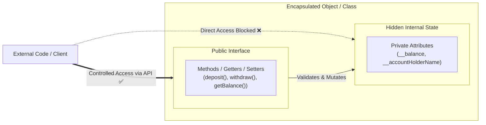
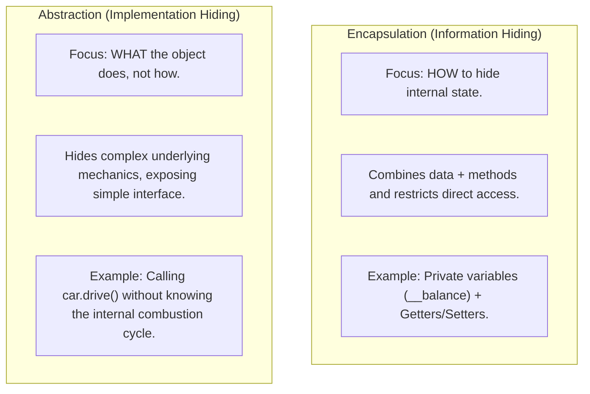

# 🟢 Day 6 — Object-Oriented Programming (OOP): Encapsulation & Data Hiding in Python

> **Interview Notes & Deep Dive**  
> Focus: Concept definition, Python data hiding mechanisms, Name Mangling, `@property` decorators, design patterns, and PBC interview questions.

---

## 📑 Contents
- [1. Executive Summary (The 30-Second Interview Pitch)](#1-executive-summary-the-30-second-interview-pitch)
- [2. What is Encapsulation?](#2-what-is-encapsulation)
- [3. Key Concepts & The Two Pillars](#3-key-concepts--the-two-pillars)
- [4. Why Encapsulation Matters (Importance & Benefits)](#4-why-encapsulation-matters-importance--benefits)
- [5. How Python Achieves Encapsulation (Access Modifiers)](#5-how-python-achieves-encapsulation-access-modifiers)
- [6. Deep Dive: Name Mangling in Python](#6-deep-dive-name-mangling-in-python)
- [7. Code Implementation: Traditional Getter & Setter (`BankAccount`)](#7-code-implementation-traditional-getter--setter-bankaccount)
- [8. The Pythonic Way: The `@property` Decorator](#8-the-pythonic-way-the-property-decorator)
- [9. Encapsulation vs. Abstraction (Classic Interview Trap)](#9-encapsulation-vs-abstraction-classic-interview-trap)
- [10. PBC Interview Questions & Answers](#10-pbc-interview-questions--answers)
- [11. Summary Flashcards](#11-summary-flashcards)

---

## 1. Executive Summary (The 30-Second Interview Pitch)

> **"What is Encapsulation?"**  
> *"Encapsulation is one of the four core pillars of Object-Oriented Programming. It is the practice of bundling data (attributes) and the methods (behavior) that operate on that data into a single unit or class, while restricting direct external access to the internal state of the object. In Python, data hiding is achieved via naming conventions (a single leading underscore `_` for protected, and double leading underscores `__` for private via name mangling), coupled with public getter/setter methods or Pythonic `@property` decorators to maintain invariants and validate data."*



---

## 2. What is Encapsulation?

**Encapsulation** comes from the word *capsule* — imagine a medical capsule sealing medicinal powders inside a protective shell. 

In software engineering:
1. **Bundling:** Packing related variables (attributes) and functions (methods) together into a cohesive class definition.
2. **Data Hiding / Information Hiding:** Concealing the internal representation and critical logic of an object from external components.

In simple terms: An object manages its own internal state. Outside code cannot directly reach into the object and arbitrarily modify its internals. Instead, the object exposes a safe, well-defined public interface (API) through which external entities must interact.

---

## 3. Key Concepts & The Two Pillars

Encapsulation rests on two interrelated concepts:

```text
                  ┌──────────────────────────────────────────────┐
                  │                 ENCAPSULATION                │
                  └──────────────────────┬───────────────────────┘
                                         │
                 ┌───────────────────────┴───────────────────────┐
                 ▼                                               ▼
   ┌───────────────────────────┐                   ┌───────────────────────────┐
   │    1. DATA BUNDLING       │                   │      2. DATA HIDING       │
   │ Attributes + Methods in   │                   │ Restricting direct access │
   │ one cohesive Class unit.  │                   │ to internal object state. │
   └───────────────────────────┘                   └───────────────────────────┘
```

### 1. Data Hiding (Restricted Access)
* Attributes within a class are not directly accessible to external code.
* Keeps sensitive fields (passwords, balances, internal IDs, state flags) hidden from unauthorized or accidental changes.

### 2. Controlled Interface (Getters & Setters)
* Direct read/write operations on internal fields are intercepted by methods.
* **Getters:** Provide read-only or formatted representations of attributes.
* **Setters:** Act as gatekeepers that enforce validation, type checks, and business rules before changing internal state.

> [!NOTE]
> **Design Principle vs. Implementation Mechanism:**
> Encapsulation is a **software design principle** (the conceptual idea of bundling and shielding). Access modifiers, naming conventions, getters/setters, and `@property` decorators are the **programming language mechanisms** used to implement that principle.

---

## 4. Why Encapsulation Matters (Importance & Benefits)

In production software systems (especially at companies like Google, Amazon, Microsoft, and Uber), unencapsulated code leads to fragile, bug-ridden architectures. Encapsulation provides 5 critical engineering benefits:

| Benefit | Why It Matters | Real-World Impact |
|---|---|---|
| **1. Data Integrity & Security** | Prevents corruption of state by enforcing business validation rules. | A bank account balance cannot accidentally become negative through an illegal direct assignment `account.balance = -5000`. |
| **2. Maintainability & Flexibility** | Internal implementations can change without breaking external caller code. | You can change internal storage from a plain `float` to a `Decimal` or encrypted string without updating any callers calling `account.getBalance()`. |
| **3. Modularity & Loose Coupling** | Bundles cohesive logic together and hides complexity behind interfaces. | Different teams can consume a service or class knowing only its public methods, without understanding its internal mechanics. |
| **4. Easier Debugging & Testing** | State changes happen exclusively through predictable methods. | You can set a single breakpoint or log statement inside `set_balance()` / `deposit()` to catch every single balance modification in the entire codebase. |
| **5. Cognitive Load Reduction** | Developers interact only with what is necessary. | Hides auxiliary helper functions and temporary state, presenting a clean, minimal API. |

---

## 5. How Python Achieves Encapsulation (Access Modifiers)

Unlike languages like C++, Java, or C# which have hard keywords (`public`, `protected`, `private`) enforced by the compiler, Python handles access control through **naming conventions** and **name mangling**.

> [!IMPORTANT]
> **The Python Philosophy:**
> *"We are all consenting adults here."* — Guido van Rossum.  
> Python trusts developers to respect conventions rather than strictly locking memory addresses.

| Access Level | Syntax | Python Behavior | Meaning / Intended Use |
|---|---|---|---|
| **Public** | `self.name` | Freely accessible from anywhere (inside and outside the class). | Standard public interface for client code. |
| **Protected** | `self._name` | Accessible from outside, but **conventionally** treated as non-public. | Intended only for the class itself and its subclasses. |
| **Private** | `self.__name` | Name-mangled by Python (`_ClassName__name`). Direct external access raises `AttributeError`. | Strictly internal state. Prevents accidental overrides in subclasses. |

---

## 6. Deep Dive: Name Mangling in Python

When you prefix an attribute with **two leading underscores** without more than one trailing underscore (e.g., `__balance`):

1. The Python interpreter automatically transforms the attribute name internally by prepending `_ClassName`.
2. `self.__balance` inside class `BankAccount` becomes `self._BankAccount__balance`.
3. If an external caller attempts `account.__balance`, Python raises:
   ```text
   AttributeError: 'BankAccount' object has no attribute '__balance'
   ```

### Can you still access a private variable in Python?
**Yes.** Because name mangling is a defensive mechanism (primarily designed to prevent attribute name clashes in subclassing), a developer can still bypass it by writing:
```python
print(account._BankAccount__balance)  # Technically works, but strongly discouraged!
```

> [!WARNING]
> Accessing a name-mangled attribute from outside the class violates the encapsulation contract and leads to brittle code that breaks when internal class names or implementations change.

---

## 7. Code Implementation: Traditional Getter & Setter (`BankAccount`)

Here is the comprehensive, clean implementation demonstrating encapsulation via traditional getter and setter methods with strict validation logic:

```python
class BankAccount:
    """
    Demonstrates OOP Encapsulation using private attributes and controlled
    public getter and setter methods.
    """

    def __init__(self, account_holder_name: str, initial_balance: float):
        # Private attributes (Name Mangling applied via double underscores)
        self.__account_holder_name = account_holder_name
        self.__balance = 0.0

        # Use the setter/deposit logic to enforce initial validation
        if initial_balance > 0:
            self.__balance = initial_balance
        else:
            print("Initial balance must be positive. Initializing balance to 0.0.")

    # --- Public Getter & Setter for Account Holder Name ---

    def get_account_holder_name(self) -> str:
        """Public getter: safely reads private attribute."""
        return self.__account_holder_name

    def set_account_holder_name(self, name: str) -> None:
        """Public setter: validates string before mutating state."""
        if isinstance(name, str) and name.strip():
            self.__account_holder_name = name.strip()
        else:
            print("Invalid name. Name must be a non-empty string.")

    # --- Public Getter for Balance ---

    def get_balance(self) -> float:
        """Public getter: allows read-only access to current balance."""
        return self.__balance

    # --- Controlled State Mutators (Business Logic) ---

    def deposit(self, amount: float) -> None:
        """
        Public mutator: validates that deposit amount is strictly positive,
        protecting internal state integrity.
        """
        if amount > 0:
            self.__balance += amount
            print(f"Successfully deposited: ${amount:.2f}")
        else:
            print("Deposit failed: Deposit amount must be positive.")

    def withdraw(self, amount: float) -> None:
        """
        Public mutator: ensures account cannot be overdrawn,
        enforcing business invariants.
        """
        if amount <= 0:
            print("Withdrawal failed: Amount must be positive.")
        elif amount > self.__balance:
            print("Withdrawal failed: Insufficient funds.")
        else:
            self.__balance -= amount
            print(f"Successfully withdrew: ${amount:.2f}")


# ==========================================
# Execution Demonstration
# ==========================================
if __name__ == "__main__":
    # 1. Instantiate the object
    account = BankAccount("John Doe", 5000.0)

    # 2. Access private data safely using public getters
    print("Account Holder :", account.get_account_holder_name())
    print("Initial Balance:", account.get_balance())

    # 3. Controlled modification via public deposit method
    account.deposit(1500.0)
    print("Updated Balance:", account.get_balance())

    # 4. Attempting an invalid deposit (Validation in action)
    account.deposit(-500.0)  # Output: Deposit failed: Deposit amount must be positive.

    # 5. Controlled modification via withdraw method
    account.withdraw(2000.0)
    print("Balance after Withdrawal:", account.get_balance())

    # 6. Attempting an overdraw (Validation in action)
    account.withdraw(10000.0)  # Output: Withdrawal failed: Insufficient funds.

    # 7. Demonstrating Data Hiding:
    try:
        # Attempting direct access to private attribute
        print(account.__balance)
    except AttributeError as e:
        print("\nDirect Access Blocked:", e)
        # AttributeError: 'BankAccount' object has no attribute '__balance'

    # 8. Behind the scenes: Name Mangling verification
    print("Access via mangled name:", account._BankAccount__balance)  # Prints: 4500.0
```

---

## 8. The Pythonic Way: The `@property` Decorator

While `get_balance()` and `set_balance()` are standard in Java and C++, Python provides a much cleaner, idiomatic way to achieve encapsulation using the **`@property` decorator**.

This gives callers a clean attribute-style syntax (`account.balance = 500`) while **still running full getter and setter validation logic under the hood**.

```python
class PremiumBankAccount:
    def __init__(self, owner: str, balance: float):
        self._owner = owner
        self._balance = balance

    # Getter
    @property
    def balance(self) -> float:
        """Getter for balance."""
        return self._balance

    # Setter
    @balance.setter
    def balance(self, value: float) -> None:
        """Setter with validation: prevents negative balance assignments."""
        if value < 0:
            raise ValueError("Balance cannot be set to a negative value.")
        self._balance = value


# Usage:
acc = PremiumBankAccount("Alice", 1000.0)
print(acc.balance)        # Calls getter: 1000.0
acc.balance = 1200.0      # Calls setter with validation: Success!

try:
    acc.balance = -500.0  # Raises ValueError: Balance cannot be set to a negative value.
except ValueError as err:
    print("Blocked by @property setter:", err)
```

> [!TIP]
> In Python interviews, mention the `@property` decorator after explaining standard getters and setters. This proves to the interviewer that you understand both fundamental OOP principles and modern, idiomatic Python patterns.

---

## 9. Encapsulation vs. Abstraction (Classic Interview Trap)

Candidates frequently confuse these two concepts. Here is the distinction:



| Dimension | Encapsulation | Abstraction |
|---|---|---|
| **Core Question** | *"How is data protected from unauthorized outside access?"* | *"What does this component do, rather than how it does it?"* |
| **Focus** | **Information hiding & bundling**. Hides state. | **Implementation hiding**. Hides internal complexity. |
| **Mechanism** | Access modifiers (`_`, `__`), getters/setters, properties. | Abstract Base Classes (`ABC`), interfaces, abstract methods. |
| **Scope** | Implemented at the class/object field level. | Implemented at the design/architectural level. |

---

## 10. PBC Interview Questions & Answers

### Q1: What is Encapsulation, and how do you achieve it in Python?
**Answer:**  
Encapsulation is bundling data and methods into a single class and restricting direct access to the object's internal state. In Python, it is achieved via:
1. **Naming Conventions:** `_var` (protected convention) and `__var` (private via name mangling).
2. **Access Methods:** Public getter/setter functions for controlled mutation.
3. **Decorators:** `@property` and `@<var>.setter` for Pythonic validation.

---

### Q2: Does Python support truly private attributes like C++ or Java?
**Answer:**  
No. Python does not enforce hard memory-level access restrictions at compile time. Instead, it uses **name mangling** for attributes starting with double underscores (`__attr`), converting them internally to `_ClassName__attr`. While this blocks direct `obj.__attr` access, the attribute can technically still be reached via `obj._ClassName__attr`. Python relies on developer consensus rather than compiler enforcement.

---

### Q3: Why should we prefer getters and setters over public attributes?
**Answer:**  
1. **Validation:** Setters allow precondition checks (e.g., ensuring `deposit > 0` or `balance >= 0`).
2. **Read-Only Fields:** Omitting the setter produces an immutable, read-only property.
3. **Lazy Evaluation & Caching:** A getter can compute values dynamically on demand or cache expensive calculations.
4. **Backward Compatibility:** Internal data representations can be refactored without altering the public API.

---

### Q4: What is the difference between single underscore `_var` and double underscore `__var`?
**Answer:**  
* `_var` (Protected Convention): A non-enforced indicator to other developers that the attribute is internal and should not be accessed outside the class or its subclasses. It also prevents import when using `from module import *`.
* `__var` (Private / Name Mangling): Triggers name mangling (`_ClassName__var`) to prevent accidental name collisions when classes are inherited.

---

### Q5: How does the `@property` decorator improve upon Java-style getters and setters?
**Answer:**  
Java-style getters (`get_x()`, `set_x()`) force callers to use verbose method syntax. The `@property` decorator allows attributes to be read and written using clean, intuitive dot-notation (`obj.x = 10`) while silently executing getter, setter, and validation logic behind the scenes. It also enables classes to start with simple public attributes and seamlessly transition to getters/setters later without breaking existing client code.

---

## 11. Summary Flashcards

```text
┌────────────────────────────────────────────────────────────────────────┐
│                      ENCAPSULATION CHEAT SHEET                         │
├──────────────────────────┬─────────────────────────────────────────────┤
│ Definition               │ Bundling data + methods; hiding state.      │
├──────────────────────────┼─────────────────────────────────────────────┤
│ Main Goal                │ Protect data integrity & control mutation.  │
├──────────────────────────┼─────────────────────────────────────────────┤
│ Public                   │ self.name (free access everywhere)          │
├──────────────────────────┼─────────────────────────────────────────────┤
│ Protected                │ self._name (convention only, be polite)     │
├──────────────────────────┼─────────────────────────────────────────────┤
│ Private                  │ self.__name (name mangled to _Class__name)  │
├──────────────────────────┼─────────────────────────────────────────────┤
│ Pythonic Approach        │ @property and @name.setter                  │
├──────────────────────────┼─────────────────────────────────────────────┤
│ Key Distinction          │ Encapsulation = Hides DATA (state)          │
│                          │ Abstraction   = Hides IMPLEMENTATION        │
└──────────────────────────┴─────────────────────────────────────────────┘
```
