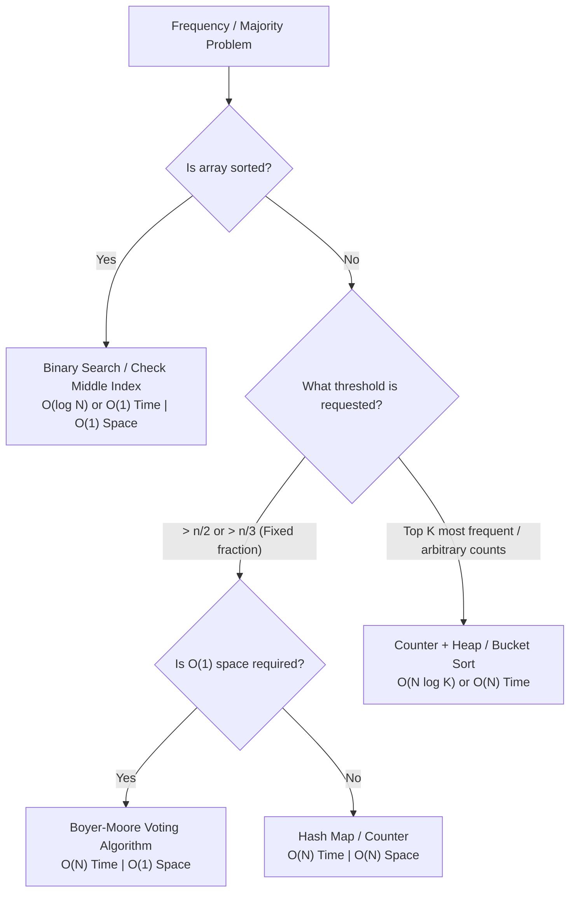

# Boyer-Moore Voting Algorithm & Frequency Elimination

Notes for DSA practice and Product-Based Company (PBC) interviews. All code is in Python.

Contents
- [Part 1: What Is the Boyer-Moore Voting Algorithm?](#part-1-what-is-the-boyer-moore-voting-algorithm)
- [Part 2: Revision Notes](#part-2-revision-notes)
- [Part 3: How to Identify and Apply Voting & Heavy Hitter Problems](#part-3-how-to-identify-and-apply-voting--heavy-hitter-problems)
- [Part 4: 5 Practice Questions (3 Confidence Boosters + 2 PBC Favorites)](#part-4-5-practice-questions-3-confidence-boosters--2-pbc-favorites)

---

## Part 1: What Is the Boyer-Moore Voting Algorithm?

### 1.1 The short answer (for interviews)

> The Boyer-Moore Voting Algorithm is an optimal linear-time, $\mathcal{O}(1)$ auxiliary space algorithm designed to find elements in an array that appear more than a certain frequency threshold (such as $> n/2$ for Majority Element-I or $> n/3$ for Majority Element-II). Instead of using a hash map to count all frequencies, it uses a **cancellation / elimination battle**: different elements cancel each other out, and any true majority element is mathematically guaranteed to survive.

### 1.2 What is a candidate and a counter?

In the voting algorithm, we maintain:
1. A **`candidate`**: a variable that stores the element currently leading the vote.
2. A **`count`**: an integer counter tracking the current net lead (votes) of that candidate.

```python
candidate = None
count = 0
```

- When `count == 0`: no candidate has active votes, so the current element becomes the new candidate with `count = 1`.
- When `num == candidate`: the candidate gets another vote (`count += 1`).
- When `num != candidate`: the current element cancels out one vote of the candidate (`count -= 1`).

### 1.3 Why do we use Boyer-Moore Voting?

To find a majority element, the obvious solutions are:
1. **Brute Force:** Two nested loops $\rightarrow \mathcal{O}(N^2)$ time, $\mathcal{O}(1)$ space. (Too slow)
2. **Sorting:** Sort the array and inspect elements $\rightarrow \mathcal{O}(N \log N)$ time, $\mathcal{O}(1)$ or $\mathcal{O}(N)$ space.
3. **Hash Map (`Counter`):** Count all occurrences $\rightarrow \mathcal{O}(N)$ time, but $\mathcal{O}(N)$ auxiliary space.

If an interviewer asks: *"Can you solve this in $\mathcal{O}(N)$ time using strictly $\mathcal{O}(1)$ extra memory?"*, a hash map is disqualified. **Boyer-Moore is the only approach that achieves both $\mathcal{O}(N)$ time and $\mathcal{O}(1)$ space.**

### 1.4 The core mental model: "The Cancellation Battle"

Think of the array as an arena of soldiers:
- Imagine an army where soldiers of the same value wear the same uniform.
- Whenever two soldiers from **different** armies meet, they duel and eliminate each other ($1$-to-$1$ cancellation).
- If one army has strictly more than $n / 2$ soldiers (more than half the battlefield), it is impossible for all other armies combined to eliminate all of them! Even if all non-majority soldiers gang up against the majority army, at least one majority soldier will remain standing at the end.

```text
Array: [7, 7, 5, 7, 5, 1, 7, 7, 3]  (n = 9, majority element 7 appears 5 times)

Pairwise Duels:
(7 vs 5) -> both eliminated
(7 vs 5) -> both eliminated
(7 vs 1) -> both eliminated
(7 vs 3) -> both eliminated
Remaining survivor: [7] -> Candidate 7 wins!
```

### 1.5 Generalizing to $> n/3$ (Triplet Cancellation)

For **Majority Element-II** (elements appearing $> n/3$ times):
- By the Pigeonhole Principle, there can be at most **2** such elements.
- Instead of pairing 2 distinct elements, we cancel **triplets of 3 mutually distinct elements**.
- If we discard 3 distinct numbers, the condition that an element appears $> n/3$ times is invariant:
  $$\frac{\text{count} - 1}{n - 3} > \frac{1}{3} \iff 3 \times \text{count} - 3 > n - 3 \iff \text{count} > \frac{n}{3}$$
- Any element that appears $> n/3$ times will survive this 3-way cancellation.

### 1.6 Why a second verification pass is needed

- For **Majority Element-I** with a guarantee that a majority element exists: the survivor from Pass 1 is automatically the answer.
- If **no guarantee** exists (or for Majority Element-II): the algorithm only guarantees that *if* a majority element exists, it must be among the survivors. Elements that survive might simply be the last numbers seen in an array with no majority (e.g. `[1, 2, 3]`).
- Therefore, a **second linear pass** is mandatory to count the actual occurrences of the candidate(s) and check against the threshold.

### 1.7 Step-by-step example: Classic Boyer-Moore (> n/2)

`nums = [2, 2, 1, 1, 1, 2, 2]` ($n = 7$, threshold $> 3.5$)

| Index `i` | `num` | `candidate` | `count` | Reason / Decision |
|:---:|:---:|:---:|:---:|:---|
| Start | - | `None` | `0` | Initial state |
| 0 | `2` | `2` | `1` | `count == 0` $\rightarrow$ pick `2` |
| 1 | `2` | `2` | `2` | `num == candidate` $\rightarrow$ vote added |
| 2 | `1` | `2` | `1` | Different number $\rightarrow$ cancelled |
| 3 | `1` | `2` | `0` | Different number $\rightarrow$ cancelled |
| 4 | `1` | `1` | `1` | `count == 0` $\rightarrow$ pick `1` |
| 5 | `2` | `1` | `0` | Different number $\rightarrow$ cancelled |
| 6 | `2` | `2` | `1` | `count == 0` $\rightarrow$ pick `2` |

**Verification Pass:** Count of `2` in `nums` is `4`. Since $4 > 7/2$, `2` is confirmed!

### 1.8 Step-by-step example: Extended Boyer-Moore (> n/3)

`nums = [1, 2, 1, 1, 3, 2, 2]` ($n = 7$, threshold $\lfloor 7/3 \rfloor = 2$)

| Step | `num` | `cand1` | `cnt1` | `cand2` | `cnt2` | Decision |
|:---:|:---:|:---:|:---:|:---:|:---:|:---|
| 0 | `1` | `1` | `1` | `None` | `0` | `cnt1 == 0` $\rightarrow$ pick `1` |
| 1 | `2` | `1` | `1` | `2` | `1` | `cnt2 == 0` $\rightarrow$ pick `2` |
| 2 | `1` | `1` | `2` | `2` | `1` | Matches `cand1` $\rightarrow$ `cnt1 += 1` |
| 3 | `1` | `1` | `3` | `2` | `1` | Matches `cand1` $\rightarrow$ `cnt1 += 1` |
| 4 | `3` | `1` | `2` | `2` | `0` | Different from both $\rightarrow$ `cnt1 -= 1`, `cnt2 -= 1` |
| 5 | `2` | `1` | `2` | `2` | `1` | `cnt2 == 0` $\rightarrow$ pick `2` |
| 6 | `2` | `1` | `2` | `2` | `2` | Matches `cand2` $\rightarrow$ `cnt2 += 1` |

**Verification Pass:**
- Count of `1` = $3 > 2 \rightarrow$ **Included**
- Count of `2` = $3 > 2 \rightarrow$ **Included**
- Final Output: `[1, 2]`

### 1.9 Time and space complexity

- **Time Complexity:** $\mathcal{O}(N)$. Pass 1 takes $N$ operations; Pass 2 takes $N$ operations. Total operations $= 2N \in \mathcal{O}(N)$.
- **Space Complexity:** $\mathcal{O}(1)$ auxiliary space. Only a fixed number of scalar variables (`candidate`, `count`) are stored, regardless of whether $N = 10$ or $N = 10^7$.

---

## Part 2: Revision Notes

### 2.1 Basic idea in one sentence
Maintain candidate(s) and counter(s) to cancel out mutually distinct groups of elements, then verify the surviving candidate(s) in a final linear pass.

### 2.2 Golden rules of voting
1. **Always check match first:** Before checking `count == 0`, check if `num == candidate`. Otherwise, you risk assigning the same number to both candidate slots!
2. **Order of conditionals matters:**
   - Check if matches candidate 1 $\rightarrow$ `count1 += 1`
   - Check if matches candidate 2 $\rightarrow$ `count2 += 1`
   - Check if `count1 == 0` $\rightarrow$ `candidate1 = num`, `count1 = 1`
   - Check if `count2 == 0` $\rightarrow$ `candidate2 = num`, `count2 = 1`
   - Else $\rightarrow$ decrement all counters (`count1 -= 1`, `count2 -= 1`)
3. **Never omit the second pass** unless the problem explicitly states: *"A majority element is guaranteed to exist."*
4. **The threshold is strict floor division:** $> \lfloor n / k \rfloor$, meaning the count must be at least $\lfloor n / k \rfloor + 1$.

### 2.3 Threshold & candidate capacity table

| Threshold | Max Number of Majority Elements | Candidates to Track | Group Size Cancelled |
|:---:|:---:|:---:|:---:|
| $> n / 2$ | $1$ | $1$ | $2$ (pairs) |
| $> n / 3$ | $2$ | $2$ | $3$ (triplets) |
| $> n / 4$ | $3$ | $3$ | $4$ (quadruplets) |
| $> n / k$ | $k - 1$ | $k - 1$ | $k$ (k-tuples) |

### 2.4 Complexity comparison

| Approach | Time Complexity | Auxiliary Space | Modifies Input? |
|---|:---:|:---:|:---:|
| Brute Force (Nested loops) | $\mathcal{O}(N^2)$ | $\mathcal{O}(1)$ | No |
| Sorting (`nums.sort()`) | $\mathcal{O}(N \log N)$ | $\mathcal{O}(1)$ or $\mathcal{O}(N)$ | Yes |
| Hash Map (`collections.Counter`) | $\mathcal{O}(N)$ | $\mathcal{O}(N)$ | No |
| **Boyer-Moore Voting** | **$\mathcal{O}(N)$** | **$\mathcal{O}(1)$** | **No** |

### 2.5 Common pitfalls & interview traps

- **Trap 1: Forgetting to verify.**
  In `[1, 2, 3]`, voting for $> n/2$ leaves candidate `3` with count `1`. Without verification, you would incorrectly return `3` as the majority element!
- **Trap 2: Duplicate candidates.**
  Writing `if count1 == 0: candidate1 = num` *before* checking `elif num == candidate2:` can cause both `candidate1` and `candidate2` to hold the same value.
- **Trap 3: Assuming odd/even makes no difference.**
  For $n = 4$, $> n/2$ means $> 2$ (at least $3$). For $n = 5$, $> n/2$ means $> 2.5$ (at least $3$). In Python, always use `count > n // 2`.

### 2.6 Pseudocode templates

#### Template 1: Classic Boyer-Moore (> n/2)

```python
def majority_element(nums):
    candidate = None
    count = 0

    # 1. Voting Pass
    for num in nums:
        if count == 0:
            candidate = num
            count = 1
        elif num == candidate:
            count += 1
        else:
            count -= 1

    # 2. Verification Pass
    actual_count = sum(1 for num in nums if num == candidate)
    return candidate if actual_count > len(nums) // 2 else -1
```

#### Template 2: Extended Boyer-Moore (> n/3)

```python
def majority_element_two(nums):
    cand1, cand2 = None, None
    cnt1, cnt2 = 0, 0

    # 1. Voting Pass
    for num in nums:
        if num == cand1:
            cnt1 += 1
        elif num == cand2:
            cnt2 += 1
        elif cnt1 == 0:
            cand1, cnt1 = num, 1
        elif cnt2 == 0:
            cand2, cnt2 = num, 1
        else:
            cnt1 -= 1
            cnt2 -= 1

    # 2. Verification Pass
    thresh = len(nums) // 3
    res = []
    if nums.count(cand1) > thresh:
        res.append(cand1)
    if cand2 != cand1 and nums.count(cand2) > thresh:
        res.append(cand2)
    return res
```

---

## Part 3: How to Identify and Apply Voting & Heavy Hitter Problems

### 3.1 Clues in the problem statement
- *"Find the element that appears more than $n / 2$ times"*
- *"Find all elements that appear more than $\lfloor n / 3 \rfloor$ times"*
- *"Return the dominant element in the array"*
- Constraint: *"Must run in $\mathcal{O}(N)$ time and $\mathcal{O}(1)$ auxiliary space"*
- *"Stream of numbers where you need to track frequent elements with bounded memory"*

### 3.2 Decision tree: Which frequency tool should you use?



### 3.3 When NOT to use Boyer-Moore
- When the problem asks for the **mode** (most frequent element) but no threshold $> n/k$ is promised. (Example: in `[1, 1, 2, 2, 3, 3, 3, 4, 4]`, $3$ has the highest frequency of 3, but $3 \not> 9/3$). Boyer-Moore will fail here; use a Hash Map or Bucket Sort.
- When you need the **complete frequency distribution** of all elements.

### 3.4 Checklist for interview problems
1. What is $n$ and what is the exact threshold ($n/2$, $n/3$, or custom)?
2. Is a majority element guaranteed to exist? (If not, write the verification pass).
3. Can the array contain negative numbers or zeros? (Ensure `candidate = None`, not `0`).
4. Can all elements be identical? (Ensure edge case passes).
5. Does the problem allow $\mathcal{O}(N)$ space? If space is not restricted, mention both Hash Map and Boyer-Moore to show comprehensive mastery.

---

## Part 4: 5 Practice Questions (3 Confidence Boosters + 2 PBC Favorites)

Here are 5 handpicked practice problems on the Boyer-Moore Voting technique and frequency thresholds:
- **Questions 1–3 (🟢 Confidence Boosters):** Clean, direct implementations to master candidate tracking, frequency validation, and binary search shortcuts.
- **Questions 4–5 (🟡 PBC Interview Favorites):** The exact problems asked at Google, Amazon, Microsoft, Meta, and Uber that test multi-candidate tracking and generalized heavy hitters.

---

## 1. Majority Element-I (> n/2) [Easy — Confidence Booster]

Given an array `nums` of size $n$, find the majority element that appears strictly more than $\lfloor n / 2 \rfloor$ times. You may assume that the majority element always exists in the array.

### Example

```text
Input:  nums = [3, 2, 3]
Output: 3

Input:  nums = [2, 2, 1, 1, 1, 2, 2]
Output: 2
```

### Think About

* Initialize `candidate = None` and `count = 0`.
* For each number: if `count == 0`, set `candidate = num`. Increment if `num == candidate`, else decrement.
* Since a majority element is guaranteed to exist, the final candidate is automatically the answer.
* **Time Complexity:** $\mathcal{O}(N)$
* **Space Complexity:** $\mathcal{O}(1)$ auxiliary space

**File:** [01.py](../../code/sprint-5/day_1_1_1/01.py)

---

## 2. Check if a Given Number is a Majority Element [Easy — Confidence Booster]

Given an array `nums` of size $n$ and a target integer `x`, determine whether `x` is the majority element of `nums` (i.e. appears strictly more than $n / 2$ times). Return `True` or `False`.

### Example

```text
Input:  nums = [1, 2, 3, 3, 3, 3, 10], x = 3
Output: True
Explanation: 3 appears 4 times out of 7 elements (4 > 3.5).

Input:  nums = [1, 1, 2, 2], x = 1
Output: False
Explanation: 1 appears 2 times out of 4 elements (2 is not > 2).
```

### Think About

* Count the occurrences of `x` in a single pass.
* Compare with `len(nums) // 2`.
* **Time Complexity:** $\mathcal{O}(N)$
* **Space Complexity:** $\mathcal{O}(1)$ auxiliary space

**File:** [02.py](../../code/sprint-5/day_1_1_1/02.py)

---

## 3. Majority Element in a Sorted Array [Easy — Confidence Booster]

Given a **sorted** array `nums` of size $n$, determine if there exists an element that appears more than $n / 2$ times. If so, return that element; otherwise, return `-1`.

### Example

```text
Input:  nums = [2, 4, 5, 5, 5, 5, 5, 6, 6]
Output: 5
Explanation: Length is 9. 5 appears 5 times > 4.

Input:  nums = [10, 20, 30, 40]
Output: -1
```

### Think About

* In a sorted array, if a majority element exists, it **must** occupy the middle index `mid = n // 2`.
* Check if `nums[mid]` appears $> n // 2$ times by inspecting boundary indices or using binary search (`bisect_left` and `bisect_right`).
* Alternatively: check if `nums[i] == nums[i + n // 2]` for any valid starting index $i$.
* **Time Complexity:** $\mathcal{O}(\log N)$ or $\mathcal{O}(1)$ with direct boundary checks.
* **Space Complexity:** $\mathcal{O}(1)$ auxiliary space

**File:** [03.py](../../code/sprint-5/day_1_1_1/03.py)

---

## 4. Majority Element-II (> n/3) [Medium — PBC Favorite: Amazon, Google, Microsoft, Uber]

Given an integer array `nums` of size $n$, find all elements that appear strictly more than $\lfloor n / 3 \rfloor$ times. Return the answer in any order.

### Example

```text
Input:  nums = [3, 2, 3]
Output: [3]

Input:  nums = [1, 2]
Output: [1, 2]

Input:  nums = [1]
Output: [1]
```

### Think About

* By the Pigeonhole Principle, at most **2** elements can appear strictly more than $\lfloor n / 3 \rfloor$ times.
* Maintain two candidates (`cand1`, `cand2`) and two counters (`cnt1`, `cnt2`).
* **Triplet Cancellation:** When a number differs from both candidates, decrement both counters (cancelling 3 mutually distinct elements).
* **Verification Pass:** Boyer-Moore only narrows down candidate identity; a second pass is mandatory to confirm actual counts $> n // 3$.
* **Time Complexity:** $\mathcal{O}(N)$
* **Space Complexity:** $\mathcal{O}(1)$ auxiliary space

**File:** [04.py](../../code/sprint-5/day_1_1_1/04.py)

---

## 5. Generalized Heavy Hitters (> n/k) — Misra-Gries Algorithm [Medium/Hard — PBC Favorite: Google, Meta, Streaming Systems]

Given an array `nums` of size $n$ and an integer $k$, find all distinct elements that appear strictly more than $\lfloor n / k \rfloor$ times. Implement the generalized Misra-Gries algorithm using $\mathcal{O}(k)$ auxiliary memory.

### Example

```text
Input:  nums = [3, 1, 2, 2, 1, 2, 3, 3], k = 4
Output: [2, 3]
Explanation: n = 8, threshold = 8 // 4 = 2. Elements appearing >= 3 times: 2 (appears 3 times) and 3 (appears 3 times).

Input:  nums = [1, 2, 3, 4, 5], k = 2
Output: []
Explanation: Threshold = 5 // 2 = 2. No element appears >= 3 times.
```

### Think About

* At most $k - 1$ elements can appear more than $\lfloor n / k \rfloor$ times.
* Maintain a dictionary `candidates` storing up to $k - 1$ active candidate elements and their vote counts.
* For each `num` in `nums`:
  * If `num in candidates`: increment `candidates[num] += 1`.
  * Else if `len(candidates) < k - 1`: add `candidates[num] = 1`.
  * Else: decrement all values in `candidates` by 1 and remove keys whose count drops to 0 (cancelling a group of $k$ distinct elements).
* **Verification Pass:** Iterate through `nums` to count the exact occurrences of all surviving keys in `candidates`. Return keys with `actual_count > n // k`.
* **Time Complexity:** $\mathcal{O}(N \times k)$
* **Space Complexity:** $\mathcal{O}(k)$ auxiliary space

**File:** [05.py](../../code/sprint-5/day_1_1_1/05.py)

