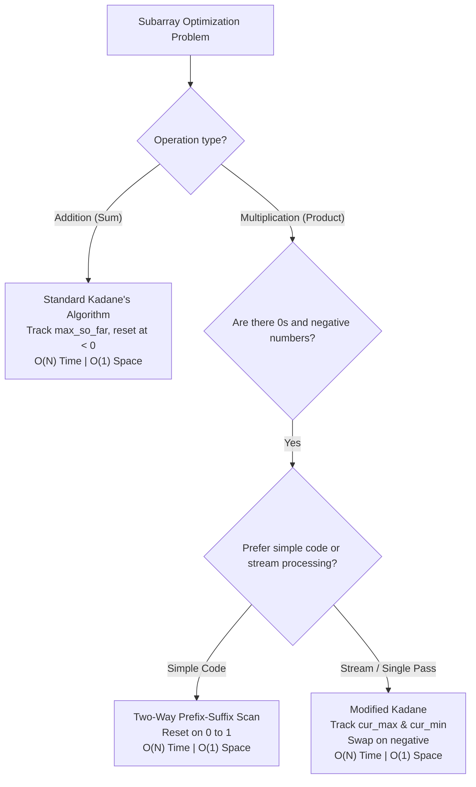

# Subarray Products & Optimization (Kadane's & Prefix-Suffix Intuition)

Notes for DSA practice and interview preparation. All code is in Python.

Contents
- [Part 1: The Multiplication Paradox & Mental Models](#part-1-the-multiplication-paradox--mental-models)
- [Part 2: Revision Notes: Sum vs. Product Optimization](#part-2-revision-notes-sum-vs-product-optimization)
- [Part 3: Decision Framework: When to Use Prefix-Suffix vs. Kadane](#part-3-decision-framework-when-to-use-prefix-suffix-vs-kadane)
- [Part 4: 2 Practice Questions (🟢 Confidence Boosters)](#part-4-2-practice-questions--confidence-boosters)

---

## Part 1: The Multiplication Paradox & Mental Models

### 1.1 Why is Subarray Product harder than Subarray Sum?

In subarray sum problems (Kadane's Algorithm), the mathematics is strictly monotonic:
- Adding a positive number **always increases** the running sum.
- Adding a negative number **always decreases** the running sum.
- Therefore, if a running sum drops below $0$, it is strictly detrimental to any future subarray, and we simply discard it (`current_sum = 0`).

In multiplication, **signs flip**:
- Multiplying by a negative number turns a large positive product into a large negative number.
- Multiplying a large negative product by **another negative number** produces an **enormous positive product**!
- Therefore, a "worst-case" running minimum can instantly become the "best-case" running maximum in a single step.

### 1.2 The Two Core Mental Models

1. **Prefix-Suffix Symmetry:**
   * If there are an even number of negative numbers, the product of the whole array is positive.
   * If there are an odd number of negative numbers, excluding the *first* negative leaves a suffix, and excluding the *last* negative leaves a prefix.
   * Hence, the maximum product subarray is always either a prefix product or a suffix product!
2. **Extreme Value Tracking (Modified Kadane):**
   * Keep track of **both** `cur_max` and `cur_min` at every step.
   * When encountering a negative number, swap `cur_max` and `cur_min`.

---

## Part 2: Revision Notes: Sum vs. Product Optimization

| Feature | Subarray Sum (Kadane) | Subarray Product (Modified Kadane / Prefix-Suffix) |
| :--- | :--- | :--- |
| **Negative Number Effect** | Always reduces sum | Can flip minimum to maximum |
| **State to Track** | `current_sum`, `max_sum` | `cur_max`, `cur_min` OR `prefix`, `suffix` |
| **Zero Element Effect** | Diminishes sum by 0 | Resets product to 0 (acts as partition) |
| **Reset Value** | `0` when `sum < 0` | `1` when `product == 0` |
| **Time Complexity** | $\mathcal{O}(N)$ | $\mathcal{O}(N)$ |
| **Space Complexity** | $\mathcal{O}(1)$ | $\mathcal{O}(1)$ |

---

## Part 3: Decision Framework: When to Use Prefix-Suffix vs. Kadane



---

## Part 4: 2 Practice Questions (🟢 Confidence Boosters)

These 2 foundational questions build direct intuition for Kadane's algorithm and the negative-negative multiplication flip.

---

## 1. Maximum Subarray Sum (Kadane's Algorithm) [Easy — Confidence Booster]

Given an integer array `nums`, find the contiguous subarray (containing at least one number) which has the largest sum, and return that sum.

### Example

```text
Input:  nums = [-2, 1, -3, 4, -1, 2, 1, -5, 4]
Output: 6
Explanation: The subarray [4, -1, 2, 1] has the largest sum = 6.

Input:  nums = [1]
Output: 1

Input:  nums = [5, 4, -1, 7, 8]
Output: 23
Explanation: The entire array has the largest sum = 23.
```

### Think About

* Maintain `current_sum = 0` and `max_sum = -infinity`.
* For each number `x`:
  * Add `x` to `current_sum`.
  * Update `max_sum = max(max_sum, current_sum)`.
  * If `current_sum < 0`, reset `current_sum = 0` (a negative prefix can never help any future subarray).
* **Time Complexity:** $\mathcal{O}(N)$
* **Space Complexity:** $\mathcal{O}(1)$ auxiliary space

**File:** [01.py](../../code/sprint-5/day_4_1_1/01.py)

---

## 2. Maximum Product of Three Numbers [Easy — Confidence Booster]

Given an integer array `nums`, find three numbers whose product is maximum and return the maximum product.

### Example

```text
Input:  nums = [1, 2, 3]
Output: 6

Input:  nums = [1, 2, 3, 4]
Output: 24

Input:  nums = [-10, -10, 5, 2]
Output: 500
Explanation:
Multiplying two large negative numbers (-10 * -10 = 100) with the largest positive number (5) yields 500, which is much larger than (5 * 2 * -10 = -100).
```

### Think About

* This directly reinforces the negative-negative multiplication principle!
* The maximum product of 3 numbers can only come from one of two candidates:
  1. Product of the 3 largest numbers: `max1 * max2 * max3`.
  2. Product of the 2 smallest (most negative) numbers and the largest number: `min1 * min2 * max1`.
* Answer: `max(max1 * max2 * max3, min1 * min2 * max1)`.
* Can be solved by sorting in $\mathcal{O}(N \log N)$ or by finding the top 3 maximums and top 2 minimums in a single pass in $\mathcal{O}(N)$ time.
* **Time Complexity:** $\mathcal{O}(N)$ (or $\mathcal{O}(N \log N)$ with sorting)
* **Space Complexity:** $\mathcal{O}(1)$ auxiliary space

**File:** [02.py](../../code/sprint-5/day_4_1_1/02.py)
