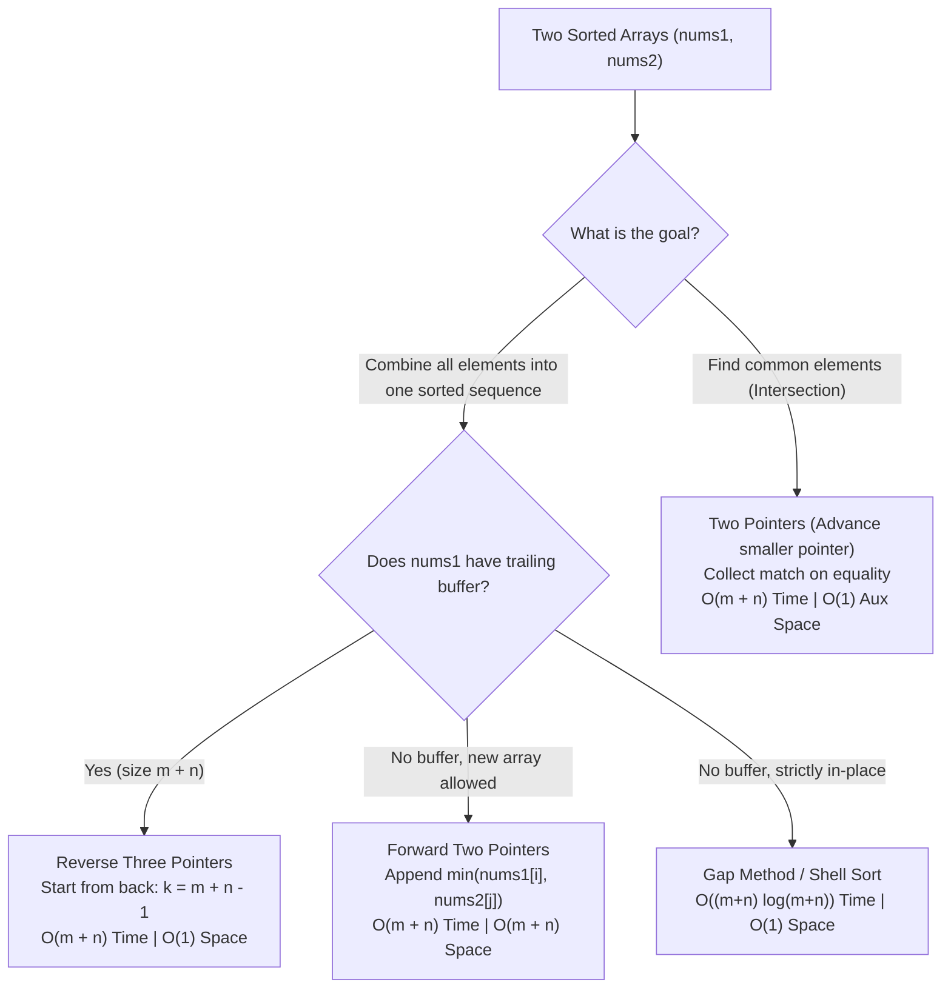

# Two-Pointer Techniques on Sorted Arrays (Merging & Set Operations)

Notes for DSA practice and interview preparation. All code is in Python.

Contents
- [Part 1: Why Sorted Arrays Give Two Pointers Superpowers](#part-1-why-sorted-arrays-give-two-pointers-superpowers)
- [Part 2: Revision Notes: Merging & In-Place Strategies](#part-2-revision-notes-merging--in-place-strategies)
- [Part 3: Decision Framework: Two-Pointer Patterns on Sorted Sequences](#part-3-decision-framework-two-pointer-patterns-on-sorted-sequences)
- [Part 4: 2 Practice Questions (🟢 Confidence Boosters)](#part-4-2-practice-questions--confidence-boosters)

---

## Part 1: Why Sorted Arrays Give Two Pointers Superpowers

In unsorted arrays, finding elements or checking relationships requires $\mathcal{O}(N^2)$ brute-force comparisons, an $\mathcal{O}(N)$ hash set, or sorting first.

In **sorted arrays**, elements obey a strict monotonic order:
$$nums[i] \le nums[i + 1]$$

This property unlocks **deterministic pointer advancement**:
1. When comparing `nums1[i]` with `nums2[j]`:
   - If `nums1[i] < nums2[j]`: `nums1[i]` is smaller than all future elements of `nums2`. To find matches or order, we **must advance `i`**.
   - If `nums1[i] > nums2[j]`: `nums2[j]` is smaller than all future elements of `nums1`. We **must advance `j`**.
   - If `nums1[i] == nums2[j]`: a match/common element is found! Advance both `i` and `j`.
2. Crucially, **pointers never need to backtrack**. Every comparison moves at least one pointer forward by 1 step, guaranteeing a strict $\mathcal{O}(m + n)$ total runtime!

---

## Part 2: Revision Notes: Merging & In-Place Strategies

| Strategy | When to Use | Pointers Direction | Time Complexity | Space Complexity |
| :--- | :--- | :--- | :--- | :--- |
| **Forward Merge (Standard)** | Allowed to return a new array | Forward (`i = 0, j = 0`) | $\mathcal{O}(m + n)$ | $\mathcal{O}(m + n)$ (New array) |
| **Reverse Merge (Buffer Available)** | `nums1` has trailing zeroes ($m + n$) | Backward (`i = m-1, j = n-1, k = m+n-1`) | $\mathcal{O}(m + n)$ | $\mathcal{O}(1)$ auxiliary space |
| **Two Pointers + Sort** | No buffer, two separate arrays | Swap largest in `nums1` with smallest in `nums2` | $\mathcal{O}(m \log m + n \log n)$ | $\mathcal{O}(1)$ auxiliary space |
| **Gap Method (Shell Sort)** | No buffer, two separate arrays | Stride of $\lceil (m + n) / 2 \rceil$ | $\mathcal{O}((m + n) \log(m + n))$ | $\mathcal{O}(1)$ auxiliary space |

---

## Part 3: Decision Framework: Two-Pointer Patterns on Sorted Sequences



---

## Part 4: 2 Practice Questions (🟢 Confidence Boosters)

These 2 foundational questions master forward two-pointer traversal, boundary termination, and sorted set operations.

---

## 1. Merge Two Sorted Arrays (Forward Two Pointers) [Easy — Confidence Booster]

Given two sorted integer arrays `nums1` of size $m$ and `nums2` of size $n$, merge them into a single sorted array `merged` and return it.

### Example

```text
Input:  nums1 = [1, 3, 5, 7], nums2 = [2, 4, 6, 8]
Output: [1, 2, 3, 4, 5, 6, 7, 8]

Input:  nums1 = [5, 10, 15], nums2 = [2, 3, 20]
Output: [2, 3, 5, 10, 15, 20]

Input:  nums1 = [1, 2], nums2 = []
Output: [1, 2]
```

### Think About

* Initialize two pointers at the beginning: `i = 0`, `j = 0`, and an empty list `merged = []`.
* While both `i < m` and `j < n`:
  * If `nums1[i] <= nums2[j]`: append `nums1[i]` to `merged`, increment `i += 1`.
  * Else: append `nums2[j]` to `merged`, increment `j += 1`.
* Append any remaining elements:
  * `merged.extend(nums1[i:])`
  * `merged.extend(nums2[j:])`
* **Time Complexity:** $\mathcal{O}(m + n)$
* **Space Complexity:** $\mathcal{O}(m + n)$ for the output array

**File:** [01.py](../../code/sprint-5/day_4_2_1/01.py)

---

## 2. Intersection of Two Sorted Arrays [Easy — Confidence Booster]

Given two sorted integer arrays `nums1` and `nums2`, return an array containing their **intersection** (the distinct common elements present in both arrays). The resulting array must be sorted in ascending order.

### Example

```text
Input:  nums1 = [1, 2, 2, 3, 4], nums2 = [2, 2, 3, 5]
Output: [2, 3]
Explanation: 2 and 3 are present in both arrays. Only distinct elements are included.

Input:  nums1 = [1, 3, 5, 7], nums2 = [2, 4, 6, 8]
Output: []
Explanation: No elements are shared between nums1 and nums2.

Input:  nums1 = [2, 2, 2], nums2 = [2, 2]
Output: [2]
```

### Think About

* Since both arrays are already sorted, we do **not** need a hash set!
* Initialize `i = 0`, `j = 0`, and `intersection = []`.
* While `i < len(nums1)` and `j < len(nums2)`:
  * If `nums1[i] < nums2[j]`: `nums1[i]` can never match any element in `nums2`, increment `i += 1`.
  * If `nums1[i] > nums2[j]`: `nums2[j]` can never match any element in `nums1`, increment `j += 1`.
  * If `nums1[i] == nums2[j]`:
    * To avoid duplicates: if `intersection` is empty or `intersection[-1] != nums1[i]`, append `nums1[i]`.
    * Increment both `i += 1` and `j += 1`.
* **Time Complexity:** $\mathcal{O}(m + n)$
* **Space Complexity:** $\mathcal{O}(1)$ auxiliary space (excluding output array)

**File:** [02.py](../../code/sprint-5/day_4_2_1/02.py)
